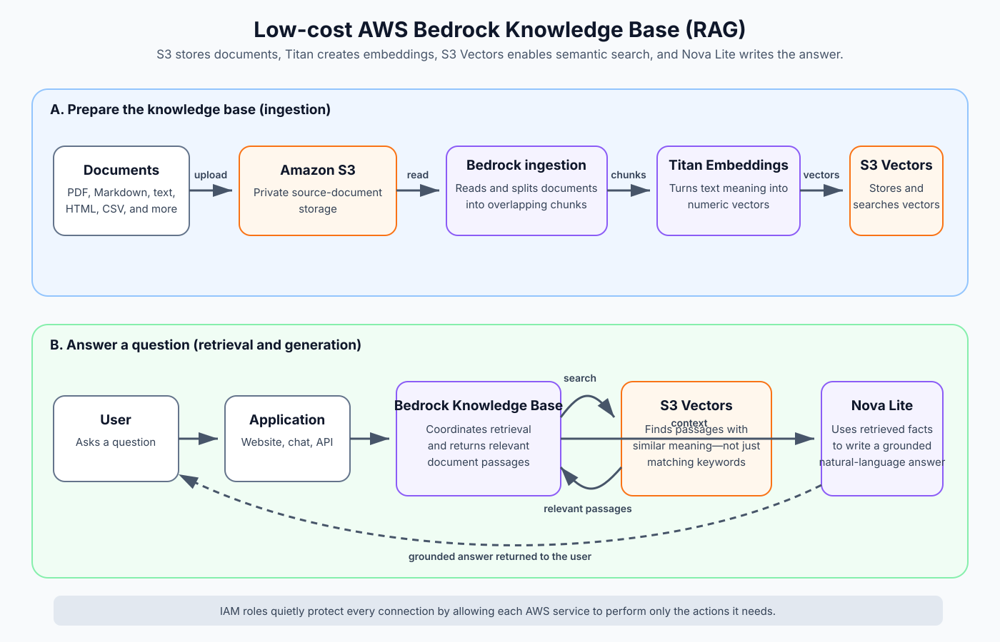

# AWS Bedrock Knowledge Base Deployment

## Summary

A low-idle-cost Amazon Bedrock Knowledge Base was deployed with Terraform in AWS account `632372330215`, region `us-east-1`.

The design used Amazon S3 Vectors instead of OpenSearch Serverless to avoid continuously running OpenSearch capacity charges. The deployment created 13 resources. It was subsequently destroyed successfully, and the Terraform state is now empty.

## Architecture

1. Documents are uploaded to a private Amazon S3 bucket.
2. A Bedrock ingestion job reads and splits the documents into chunks.
3. Amazon Titan Text Embeddings V2 converts each chunk into a numerical vector.
4. The vectors are stored in an Amazon S3 vector index.
5. A user asks a question.
6. Bedrock embeds the question and searches for semantically similar document chunks.
7. Amazon Nova Lite can use the retrieved chunks to generate a grounded answer.

This pattern is known as retrieval-augmented generation (RAG).

## Why take this approach?

A general-purpose AI model knows broad information, but it does not automatically know the contents of private company documents, current procedures, product manuals, or internal policies. Copying every document into every prompt would be slow, expensive, and likely to exceed the model's input limit.

RAG solves this by separating **finding information** from **writing the answer**:

1. The retrieval system finds a small number of passages that are relevant to the question.
2. The generation model receives the question plus those passages and writes an answer grounded in them.

This approach is useful because it:

- **Uses private or custom information:** Answers can be based on documents that were never part of the model's original training.
- **Keeps information easier to update:** Replace a document and re-ingest it instead of retraining an AI model.
- **Reduces hallucinations:** The model receives relevant source material instead of relying only on its general knowledge.
- **Supports citations:** Retrieved passages can be shown as evidence for an answer.
- **Controls cost:** Only relevant chunks are sent to the generation model. S3 Vectors also avoids continuously running OpenSearch compute for a small workload.
- **Separates responsibilities:** Storage, retrieval, generation, and permissions can each be secured and changed independently.
- **Scales gradually:** The same pattern can support a small proof of concept or a larger document collection without redesigning the whole workflow.

This architecture is a good fit for document question answering, internal support assistants, policy lookup, product documentation, and research collections. It is not a substitute for transactional databases or workflows that require guaranteed deterministic answers.

## Why each service is required

### Amazon S3 — the document library

S3 stores the original files. Think of it as a secure online filing cabinet. Bedrock needs a dependable place from which it can read PDFs, text files, Markdown, HTML, CSV, and other supported documents.

Why it is needed:

- Keeps the original source material in one durable location.
- Supports encryption, access controls, and version history.
- Lets documents be added or replaced without changing the application.

S3 does not understand what a document means; it only stores the files. That is why an embedding model and vector store are also needed.

### Bedrock data source and ingestion — the librarian

The data source tells Bedrock which S3 bucket contains the documents. An ingestion job reads those files and divides them into smaller, overlapping chunks.

Why it is needed:

- A whole document is often too large and too broad to use as context for one question.
- Smaller chunks let the system retrieve the specific paragraph or section that matters.
- Overlap prevents useful sentences near a chunk boundary from losing their surrounding context.

In this design, chunks were limited to 300 tokens with 20% overlap.

### Titan Text Embeddings V2 — the meaning translator

Titan converts each text chunk into a list of numbers called a vector. Text with similar meaning produces vectors that are mathematically close, even when it uses different words.

For example, “How do I reset my password?” can be matched with “Account credential recovery” even though the wording is different.

Why it is needed:

- Computers cannot perform semantic similarity search directly over ordinary paragraphs.
- Embeddings provide a numerical representation of meaning.
- The same model embeds both stored document chunks and incoming questions so they can be compared consistently.

An embedding model does not write the final answer. Its job is to make meaning searchable.

### Amazon S3 Vectors — the semantic index

S3 Vectors stores the embeddings and searches for vectors closest to the question vector. It acts like an index at the back of a book, except it searches by meaning rather than exact keywords.

Why it is needed:

- Searching every document chunk one at a time would be inefficient.
- A vector index quickly returns the most semantically relevant chunks.
- It provides a lower-idle-cost option for this small workload than an always-on OpenSearch Serverless design.

The vector index was configured for 1,024-dimensional Titan embeddings and cosine similarity.

### Bedrock Knowledge Base — the coordinator

The Knowledge Base connects the data source, embedding model, vector index, and retrieval API. It manages the RAG-specific workflow so the application does not need custom ingestion and retrieval code for every component.

Why it is needed:

- Provides one managed interface for ingestion and retrieval.
- Knows how to turn a question into an embedding and search the configured index.
- Returns relevant source passages and metadata to the calling application.

It does not permanently run a server. It is managed configuration that coordinates AWS services when called.

### Amazon Nova Lite — the answer writer

Nova Lite receives the user's question and the passages found by the Knowledge Base. It turns that context into a concise natural-language answer.

Why it is needed:

- Vector search returns passages, not a polished response.
- The model can summarize, combine, and explain information from several retrieved passages.
- Nova Lite is a relatively economical generation model for a small solution.

The application should instruct the model to answer from the retrieved context and admit when the context does not contain an answer.

### IAM roles and policies — the security guards

IAM determines which service can perform which action. Bedrock received a service role that could read the specific document bucket, invoke the embedding model, and use the specific vector index. A separate invocation role allowed controlled access to Nova Lite.

Why it is needed:

- AWS denies cross-service access unless it is explicitly authorized.
- Least-privilege policies limit the impact of mistakes or compromised credentials.
- Separate roles prevent document ingestion permissions from being mixed with application-generation permissions.

IAM does not process documents or answer questions, but the architecture cannot operate securely without it.

### Terraform — the repeatable blueprint

Terraform describes all resources and their relationships as code. It is not part of the live question-answer path, but it makes the environment repeatable and auditable.

Why it is useful:

- The same architecture can be recreated consistently.
- A plan shows proposed changes before deployment.
- Related resources can be destroyed together after a test.
- Configuration can be reviewed and version-controlled.

### Random ID — the naming helper

The random suffix makes globally unique bucket names and prevents collisions with names already used by another AWS customer. It has no runtime role and no AWS cost.

## Two distinct workflows

### Ingestion workflow

This happens when documents are added or changed:

`Document → S3 → Bedrock ingestion → Titan embeddings → S3 Vectors`

Embedding and vector-storage charges occur during this workflow. It does not need to run continuously.

### Question-answer workflow

This happens for each user question:

`Question → Knowledge Base retrieval → S3 Vectors → relevant passages → Nova Lite → answer`

Retrieval and model-invocation charges occur during this workflow. If nobody asks questions, Nova Lite is not running in the background.

## Resources created

### 1. Bedrock Knowledge Base

**Terraform resource:** `aws_bedrockagent_knowledge_base.this`

The central RAG resource. It connected the embedding model, S3 vector index, IAM service role, and document data source.

Deployed ID: `QAFQ1JENV3`

### 2. Bedrock data source

**Terraform resource:** `aws_bedrockagent_data_source.documents`

Told the Knowledge Base where source documents were stored. It was configured to use the document S3 bucket.

Chunking configuration:

- Fixed-size chunks
- Maximum 300 tokens per chunk
- 20% overlap between chunks

Deployed ID: `L1XSKGVHZJ`

No ingestion job was run because no documents were uploaded.

### 3. S3 document bucket

**Terraform resource:** `aws_s3_bucket.documents`

Stored original source documents such as PDF, Markdown, text, HTML, CSV, and supported office documents.

Deployed name: `custom-bedrock-kb-07b44c39-documents`

#### Supporting bucket configuration

- `aws_s3_bucket_public_access_block.documents` blocked all public access.
- `aws_s3_bucket_server_side_encryption_configuration.documents` enabled AES-256 encryption at rest.
- `aws_s3_bucket_versioning.documents` enabled object versioning for recovery.

The test configuration used `force_destroy = true`, allowing Terraform to delete all object versions when destroying the bucket. This setting should be reconsidered for production data.

### 4. S3 vector bucket

**Terraform resource:** `aws_s3vectors_vector_bucket.knowledge_base`

Stored numerical document embeddings for semantic search.

Deployed name: `custom-bedrock-kb-07b44c39-vectors`

S3 Vectors was selected instead of OpenSearch Serverless to avoid an always-on OpenSearch OCU charge.

### 5. S3 vector index

**Terraform resource:** `aws_s3vectors_index.knowledge_base`

Defined how embeddings were stored and compared.

Configuration:

- Index name: `knowledge-base-index`
- Dimensions: 1,024
- Data type: `float32`
- Distance metric: cosine similarity
- Encryption: AES-256

The 1,024 dimensions matched the configured Titan Text Embeddings V2 output.

### 6. Knowledge Base IAM role

**Terraform resource:** `aws_iam_role.knowledge_base`

Allowed the Amazon Bedrock service to operate the Knowledge Base. The trust policy allowed `bedrock.amazonaws.com` to assume the role and restricted use to the owning AWS account and Bedrock Knowledge Bases in `us-east-1`.

Deployed name: `custom-bedrock-kb-07b44c39-kb-role`

### 7. Knowledge Base IAM policy

**Terraform resource:** `aws_iam_role_policy.knowledge_base`

Granted the Knowledge Base permission to:

- Invoke Titan Text Embeddings V2
- List and read source documents from the S3 bucket
- Read, write, query, and delete vectors in the S3 vector index

### 8. Model invocation IAM role

**Terraform resource:** `aws_iam_role.bedrock_invocation[0]`

Provided a role that an application or authorized administrator could assume to invoke Amazon Nova Lite.

Deployed name: `bedrock-model-invocation-role`

The test trust policy used the AWS account root principal. An identity would still require `sts:AssumeRole` permission. For production, the trust policy should name a specific application role rather than the account root principal.

### 9. Model invocation IAM policy

**Terraform resource:** `aws_iam_role_policy.bedrock_invoke[0]`

Allowed these actions:

- `bedrock:InvokeModel`
- `bedrock:InvokeModelWithResponseStream`

Access was restricted to Amazon Nova Lite rather than all Bedrock models.

### 10. Random suffix

**Terraform resource:** `random_id.suffix`

Generated the unique suffix `07b44c39` to prevent naming collisions for globally unique resources such as S3 buckets.

This was a Terraform-only resource and had no AWS cost.

## Models referenced

### Amazon Titan Text Embeddings V2

Model ID: `amazon.titan-embed-text-v2:0`

Purpose: Converts document chunks and user questions into 1,024-dimensional numerical vectors for semantic retrieval.

### Amazon Nova Lite

Model ID: `amazon.nova-lite-v1:0`

Purpose: Generates natural-language responses using passages retrieved from the Knowledge Base.

Both are AWS-managed models. Terraform referenced them but did not create or reserve model instances.

## Cost characteristics

The deployment had no continuously running compute resources.

Idle resources included:

- IAM roles and policies: no charge
- Bedrock Knowledge Base metadata: no hourly compute charge
- Empty S3 bucket: effectively no storage cost
- Empty S3 vector bucket and index: no OpenSearch-style always-on OCU charge
- Bedrock models: charged only when invoked

Charges would begin when documents were stored, ingestion generated embeddings, vectors were stored or queried, and Nova Lite generated answers.

For a small test dataset and light usage, costs would generally be expected to remain in the pennies-to-low-dollar range. Current AWS pricing should always be checked before production use.

## Deployment result

Terraform created 13 resources successfully:

- 1 Bedrock Knowledge Base
- 1 Bedrock data source
- 1 S3 document bucket
- 3 S3 bucket configuration resources
- 1 S3 vector bucket
- 1 S3 vector index
- 2 IAM roles
- 2 inline IAM policies
- 1 random ID

## Destruction result

Terraform later destroyed all 13 resources successfully.

Final status:

- Knowledge Base deleted
- Data source deleted
- S3 document bucket and contents deleted
- S3 vector index deleted
- S3 vector bucket deleted
- IAM roles and policies deleted
- Terraform state empty
- Terraform configuration files retained for future redeployment

## Terraform project location

`/Users/tevin/ResilioSync/Development (1)/AWS/bedrock`

## Operational commands

Preview a future deployment:

    AWS_PROFILE=Terraformmm-local terraform plan

Deploy after reviewing the plan:

    AWS_PROFILE=Terraformmm-local terraform apply

Destroy all resources tracked by the project:

    AWS_PROFILE=Terraformmm-local terraform destroy

## Production recommendations

- Use a remote encrypted Terraform backend with state locking.
- Set `force_destroy = false` for production data buckets.
- Trust a specific application role instead of the account root principal.
- Add AWS Budgets alerts and cost-allocation tags.
- Add lifecycle rules for old S3 object versions.
- Separate development and production environments and state.
- Review document sensitivity and data-retention requirements.
- Validate current Bedrock model availability and pricing before deployment.
