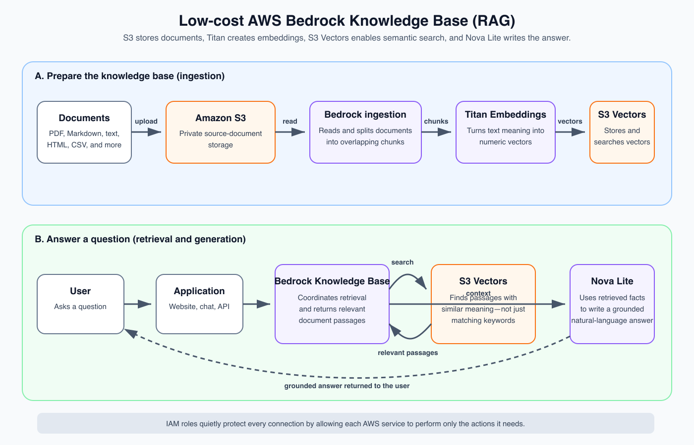

# Amazon Bedrock Knowledge Base

Terraform configuration for a low-idle-cost retrieval-augmented generation (RAG) environment on AWS.

## Architecture



Documents are uploaded to a private S3 bucket and ingested by Amazon Bedrock. Titan Text Embeddings V2 converts document chunks into vectors stored in S3 Vectors. At query time, the Knowledge Base retrieves relevant chunks and Nova Lite generates a grounded answer.

### Components

- Amazon Bedrock Knowledge Base
- Private, encrypted, and versioned S3 document bucket
- Amazon S3 Vectors index
- Amazon Titan Text Embeddings V2
- Amazon Nova Lite for on-demand answer generation
- Least-privilege AWS IAM roles and policies

## Prerequisites

- Terraform 1.5 or newer
- AWS CLI v2
- An AWS identity with permission to manage the configured resources
- Access to the selected Bedrock models in `us-east-1`

## Authentication

```shell
aws sso login --profile Terraformmm-local
```

## Deploy

From this directory:

```shell
AWS_PROFILE=Terraformmm-local terraform init
AWS_PROFILE=Terraformmm-local terraform validate
AWS_PROFILE=Terraformmm-local terraform plan
AWS_PROFILE=Terraformmm-local terraform apply
```

After deployment, upload documents to the generated S3 document bucket and sync the Knowledge Base data source.

## Configuration

Copy `terraform.tfvars.example` to `terraform.tfvars` to change the region, models, trusted principals, or tags. Do not store AWS credentials in Terraform files.

The defaults use:

- Generation model: `amazon.nova-lite-v1:0`
- Embedding model: `amazon.titan-embed-text-v2:0`
- Region: `us-east-1`

## Destroy

```shell
AWS_PROFILE=Terraformmm-local terraform destroy
```

> The test configuration enables `force_destroy`, so destroying the environment also deletes documents and vectors stored in its managed buckets.
